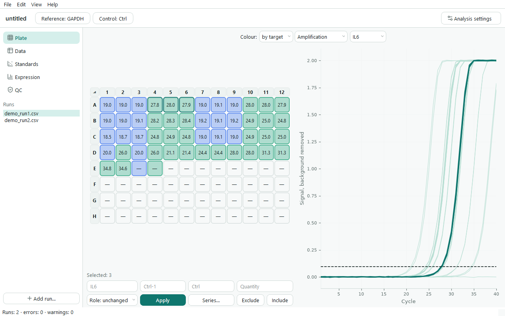
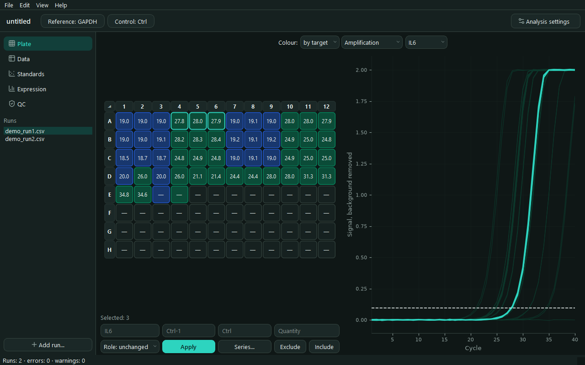
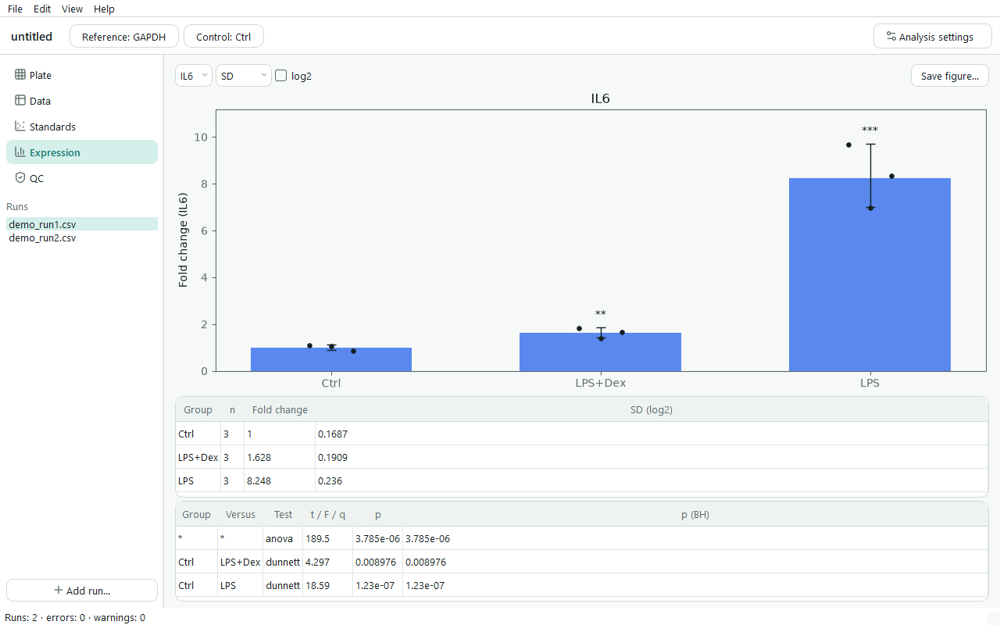

#  qpcrkit

English | [Русский](README.ru.md)

Open-source desktop tool for **qPCR data analysis**: import Cq tables and raw curves
from the instrument, check replicates and controls, fit standard curves, calculate
relative expression (ΔΔCt / Pfaffl) with statistics, and export tables and
publication-ready figures. Offline, free, English/Russian interface — a
replacement for the ΔΔCt spreadsheet most labs keep in Excel.

Part of a small family of lab tools: [platekit](https://github.com/adrobi/platekit)
plans the plate, qpcrkit analyses the run, [ab1kit](https://github.com/adrobi/ab1kit)
handles Sanger reads.





## Features

**Import**
- Bio-Rad CFX Maestro, Applied Biosystems QuantStudio / 7500 and Design & Analysis,
  Qiagen Rotor-Gene Q exports (CSV, TXT, XLSX) and RDML, detected automatically.
- Several files of one CFX run, or a whole folder, by drag and drop.
- Amplification and melt curves come along from CFX, QuantStudio and RDML.
- Any other table through a column-mapping wizard with reusable presets.
- Plate layouts from platekit (`.platekit.json` or its instrument layout CSVs).
- Several plates in one experiment, aligned with inter-run calibrators (IRC).

**Analysis**
- QC: technical replicate spread, suggested outliers (never removed silently),
  NTC contamination, late amplification; every issue links to its well.
- Standard curves: slope, R², efficiency, lowest detected standard, absolute
  quantification with extrapolation warnings.
- Relative expression with any number of reference genes (geometric mean) and
  per-target efficiency — from the curve, entered manually or 100 % (classic ΔΔCt).
- Statistics on the log2 scale: SD / SEM / 95 % CI, Welch t-test, one-way ANOVA
  with Dunnett or Tukey, Benjamini–Hochberg across targets.

**Curves**
- Baseline, Cq at a common threshold, per-well efficiency in a window of linearity
  (as in LinRegPCR), melt peaks and Tm.
- The instrument's Cq stays the default; Cq and efficiency from curves are an explicit
  choice in the analysis settings.
- Extra checks: several melt peaks, Tm shift, a product or dimers in the NTC, a Cq the
  curve does not support, a very early Cq.

**Results**
- Fold-change charts with replicate points and significance stars; standard
  curve plots, amplification and melt plots. SVG / PDF / PNG 300 dpi.
- Excel workbook (raw data, QC, curves, quantities, expression, statistics and
  every analysis parameter for MIQE-style reporting), CSV, printable HTML report.
- Projects are plain JSON (`*.qpcrkit.json`): raw data, annotations and
  exclusions are stored, results are always recalculated.

**Desktop**
- The plate and its curves side by side: selecting wells highlights curves, clicking a
  curve selects its well. The threshold line can be dragged when one target is shown.
- Mark up wells right under the plate; name samples in series, paste a plate map or a
  *sample — group* table from Excel. Undo/redo, automatic recalculation.
- A hint line says what is missing next. Click a point on a standard curve to exclude it.
- The theme follows the system; light and dark can be chosen.
- Command line for batch work: `qpcrkit inspect | new | analyze`.

## Download

Ready-made builds are on the [Releases](https://github.com/adrobi/qpcrkit/releases)
page: `qpcrkit-windows-x64.exe` (no installation needed) and
`qpcrkit-linux-x86_64.tar.gz`.

## Run from source

```bash
git clone https://github.com/adrobi/qpcrkit.git
cd qpcrkit
python -m venv .venv
.venv/Scripts/activate        # Linux/macOS: source .venv/bin/activate
pip install -e ".[dev]"
qpcrkit                       # opens the desktop application
```

Python 3.11–3.13. Dependencies: PySide6, numpy, scipy, matplotlib, openpyxl.

## Quick start

1. Drop instrument files on the window, or press **Demo data** on the start screen for a
   ready project with curves.
2. Select wells on the plate and set target, sample, group and role in the panel under it,
   or import the layout from platekit. The hint line says what is still missing.
3. In the top bar, choose the **Reference** gene(s) and the **Control** group.
4. Look at **QC**, **Standards** and **Expression**; export from the **File** menu (Excel, CSV, HTML report, figures).

The same from the command line:

```bash
qpcrkit new examples/demo_run1.csv examples/demo_run2.csv --ref GAPDH --control Ctrl -o demo.qpcrkit.json
qpcrkit analyze demo.qpcrkit.json -o results.xlsx --html report.html --figures figures/
```

`qpcrkit new` also takes folders, `qpcrkit analyze --cq-source calculated` uses the Cq from curves.

## How the numbers are calculated

- Calibrated Cq = Cq − CF(run); CF is the mean deviation of the run's IRCs from
  their mean over runs (qbase, Hellemans et al. 2007).
- RQ = (1+E<sub>target</sub>)<sup>ΔCq</sup> / geomean over references of
  (1+E<sub>ref</sub>)<sup>ΔCq</sup>, ΔCq = Cq(control) − Cq(sample) (Pfaffl 2001).
- Group statistics and tests use log2(RQ) of biological replicates.

### How the curve results compare with instruments

Checked on public example files of several instruments; the tests in `tests/test_real_curves.py`
repeat this on the files in the repository.

- **Cq:** a threshold is a choice, so what matters is that the difference from the instrument stays
  constant within a target. On targets with at least 6 reactions its SD was 0.02–0.13 cycles on
  QuantStudio, StepOne and one CFX plate, and 0.11–0.26 on BioRad, LC96 and another CFX plate. On a plate
  with Cq down to 4 it was 0.61: such curves have almost no baseline, and QC warns about them. Files with
  CRT report a relative threshold for each well, so this comparison does not apply to them.
- **Tm:** within 0.3 °C of the instrument on 96 wells.
- **Efficiency:** from curves it is an estimate, usually lower than from dilutions on TaqMan data,
  where the signal leaves the exponent early: 0.88 against 0.96, and 0.80 against 0.99 on a noisy plate.
  Curves with the background already removed are marked as less reliable.

## Development

```bash
pytest -q
```

Tests cover the calculations against reference values and instrument results, every importer,
the CLI and the GUI (offscreen). Releases are built by GitHub Actions on a `v*` tag.

## License

MIT © Aleksey Drobin ([@adrobi](https://github.com/adrobi))
