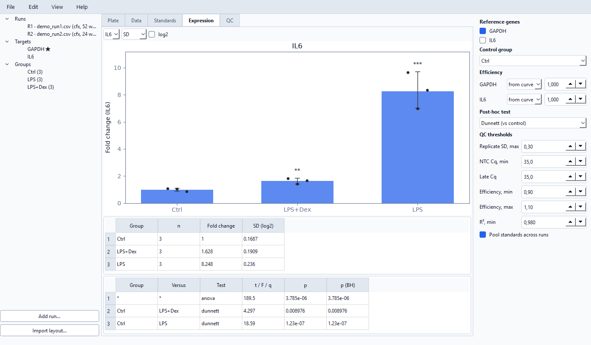
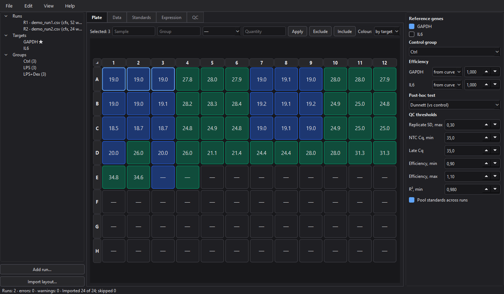

#  qpcrkit

[English](README.md) | Русский

Настольная программа с открытым исходным кодом для **анализа данных кПЦР**: импорт таблиц Cq из прибора, проверка реплик и контролей, построение стандартных кривых, расчёт относительной экспрессии (ΔΔCt / метод Пфаффла) со статистикой, экспорт таблиц и рисунков, готовых к публикации. Работает офлайн, бесплатна, интерфейс на английском и русском — замена таблице ΔΔCt в Excel, которая есть почти в каждой лаборатории.

Входит в небольшое семейство лабораторных инструментов: [platekit](https://github.com/adrobi/platekit) планирует планшет, qpcrkit анализирует запуск, [ab1kit](https://github.com/adrobi/ab1kit) работает с ридами секвенирования по Сэнгеру.




## Возможности

**Импорт**
- Экспорт из Bio-Rad CFX Maestro, Applied Biosystems QuantStudio / 7500, Qiagen Rotor-Gene Q (CSV, TXT, XLSX); формат определяется автоматически.
- Любая другая таблица — через мастер сопоставления столбцов с сохраняемыми шаблонами.
- Схемы планшетов из platekit (`.platekit.json` или его CSV-файлы схем для приборов).
- Несколько планшетов в одном эксперименте, выровненных с помощью межпланшетных калибраторов (IRC).

**Анализ**
- QC: разброс технических реплик, предлагаемые выбросы (никогда не удаляются без вашего ведома), контаминация в NTC (контроле без матрицы), поздняя амплификация; каждая проблема ссылается на соответствующую лунку.
- Стандартные кривые: наклон, R², эффективность, наименьший детектируемый стандарт, абсолютная количественная оценка с предупреждениями об экстраполяции.
- Относительная экспрессия с любым числом референсных генов (среднее геометрическое) и эффективностью для каждой мишени — из стандартной кривой, введённой вручную или 100 % (классический ΔΔCt).
- Статистика в шкале log2: SD / SEM / 95 % ДИ, t-критерий Уэлча, однофакторный ANOVA с пост-хок тестом Даннета или Тьюки, поправка Бенджамини — Хохберга по мишеням.

**Результаты**
- Графики кратности изменения экспрессии с точками отдельных реплик и звёздочками значимости; графики стандартных кривых. SVG / PDF / PNG, 300 dpi.
- Книга Excel (исходные данные, QC, кривые, количества, экспрессия, статистика и все параметры анализа для отчётности по MIQE), CSV, HTML-отчёт для печати.
- Проекты хранятся в обычном JSON (`*.qpcrkit.json`): сохраняются исходные данные, аннотации и исключения, а результаты всегда пересчитываются заново.

**Рабочее место**
- Вид планшета с выделением мышью, таблица данных со вставкой из Excel, отмена и повтор действий, автоматический пересчёт, светлая и тёмная темы.
- Командная строка для пакетной обработки: `qpcrkit inspect | new | analyze`.

## Скачать

Готовые сборки лежат на странице [Releases](https://github.com/adrobi/qpcrkit/releases): `qpcrkit-windows-x64.exe` (установка не нужна) и `qpcrkit-linux-x86_64.tar.gz`.

## Запуск из исходного кода

```bash
git clone https://github.com/adrobi/qpcrkit.git
cd qpcrkit
python -m venv .venv
.venv/Scripts/activate        # Linux/macOS: source .venv/bin/activate
pip install -e ".[dev]"
qpcrkit                       # открывает приложение
```

Python 3.11–3.13. Зависимости: PySide6, numpy, scipy, matplotlib, openpyxl.

## Быстрый старт

1. **Файл → Добавить запуск…** (**File → Add run…**) и выберите файл экспорта из прибора (можно попробовать `examples/demo_run1.csv` и `examples/demo_run2.csv`).
2. Проверьте группы образцов на вкладке **«Данные»** (**Data**) — вставьте из Excel таблицу *образец — группа* через Ctrl+V — или импортируйте схему планшета из platekit.
3. Справа отметьте референсный ген (гены) и выберите контрольную группу.
4. Посмотрите вкладки **«QC»**, **«Стандарты»** (**Standards**) и **«Экспрессия»** (**Expression**); экспортируйте через **Файл → Экспорт** (**File → Export**).

То же самое из командной строки:

```bash
qpcrkit new examples/demo_run1.csv examples/demo_run2.csv --ref GAPDH --control Ctrl -o demo.qpcrkit.json
qpcrkit analyze demo.qpcrkit.json -o results.xlsx --html report.html --figures figures/
```

## Как рассчитываются значения

- Калиброванный Cq = Cq − CF(запуск); CF — среднее отклонение IRC данного запуска от их среднего по всем запускам (qbase, Hellemans et al. 2007).
- RQ = (1+E<sub>target</sub>)<sup>ΔCq</sup> / среднее геометрическое по референсным генам от (1+E<sub>ref</sub>)<sup>ΔCq</sup>, ΔCq = Cq(контроль) − Cq(образец) (Pfaffl 2001).
- Статистика по группам и критерии используют log2(RQ) биологических реплик.

## Разработка

```bash
pytest -q
```

Тесты проверяют расчёты по эталонным значениям, каждый импортёр, командную строку и графический интерфейс (в режиме offscreen). Релизы собираются GitHub Actions по тегу `v*`.

## Лицензия

MIT © Aleksey Drobin ([@adrobi](https://github.com/adrobi))
