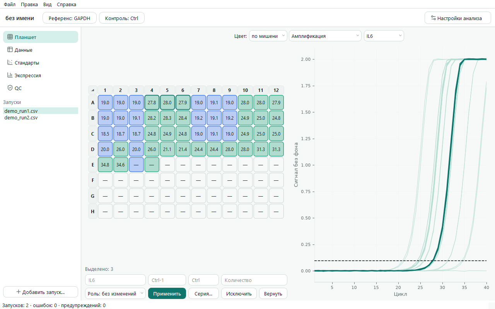
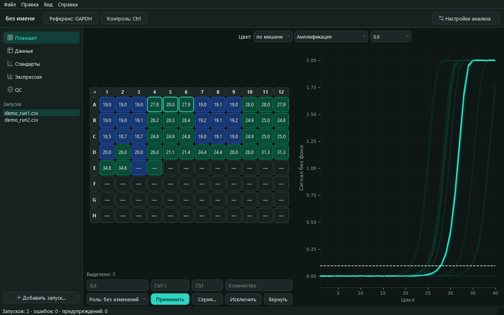
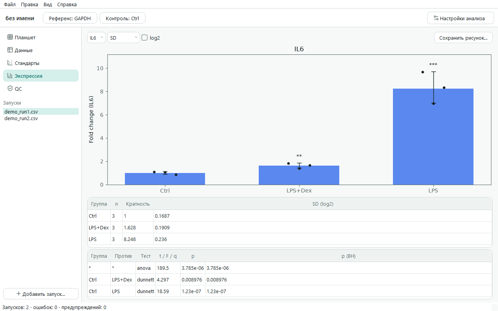

#  qpcrkit

[English](README.md) | Русский

Настольная программа с открытым исходным кодом для **анализа данных кПЦР**: импорт таблиц Cq и исходных кривых из прибора, проверка реплик и контролей, построение стандартных кривых, расчёт относительной экспрессии (ΔΔCt / метод Пфаффла) со статистикой, экспорт таблиц и рисунков, готовых к публикации. Работает офлайн, бесплатна, интерфейс на английском и русском — замена таблице ΔΔCt в Excel, которая есть почти в каждой лаборатории.

Входит в небольшое семейство лабораторных инструментов: [platekit](https://github.com/adrobi/platekit) планирует планшет, qpcrkit анализирует запуск, [ab1kit](https://github.com/adrobi/ab1kit) работает с ридами секвенирования по Сэнгеру.





## Возможности

**Импорт**
- Экспорт из Bio-Rad CFX Maestro, Applied Biosystems QuantStudio / 7500 и Design & Analysis, Qiagen Rotor-Gene Q (CSV, TXT, XLSX), а также RDML; формат определяется автоматически.
- Несколько файлов одного запуска CFX или целую папку можно просто перетащить в окно.
- Кривые амплификации и плавления импортируются из CFX, QuantStudio и RDML.
- Любая другая таблица — через мастер сопоставления столбцов с сохраняемыми шаблонами.
- Схемы планшетов из platekit (`.platekit.json` или его CSV-файлы схем для приборов).
- Несколько планшетов в одном эксперименте, выровненных с помощью межпланшетных калибраторов (IRC).

**Анализ**
- QC: разброс технических реплик, предлагаемые выбросы (никогда не удаляются без вашего ведома), контаминация в NTC (контроле без матрицы), поздняя амплификация; каждая проблема ссылается на соответствующую лунку.
- Стандартные кривые: наклон, R², эффективность, наименьший детектируемый стандарт, абсолютная количественная оценка с предупреждениями об экстраполяции.
- Относительная экспрессия с любым числом референсных генов (среднее геометрическое) и эффективностью для каждой мишени — из стандартной кривой, введённой вручную или 100 % (классический ΔΔCt).
- Статистика в шкале log2: SD / SEM / 95 % ДИ, t-критерий Уэлча, однофакторный ANOVA с пост-хок тестом Даннета или Тьюки, поправка Бенджамини — Хохберга по мишеням.

**Кривые**
- Базовая линия, Cq по общему порогу, эффективность каждой лунки в окне линейности (как в LinRegPCR), пики плавления и Tm.
- По умолчанию используется Cq прибора; Cq и эффективность по кривым включаются явно в настройках анализа.
- Дополнительные проверки: несколько пиков плавления, сдвиг Tm, продукт или димеры в NTC, Cq, который кривая не подтверждает, очень ранний Cq.

**Результаты**
- Графики кратности изменения экспрессии с точками отдельных реплик и звёздочками значимости; графики стандартных кривых, амплификации и плавления. SVG / PDF / PNG, 300 dpi.
- Книга Excel (исходные данные, QC, кривые, количества, экспрессия, статистика и все параметры анализа для отчётности по MIQE), CSV, HTML-отчёт для печати.
- Проекты хранятся в обычном JSON (`*.qpcrkit.json`): сохраняются исходные данные, аннотации и исключения, а результаты всегда пересчитываются заново.

**Рабочее место**
- Планшет и его кривые рядом: выделенные лунки подсвечивают кривые, клик по кривой выделяет лунку. Линию порога можно перетаскивать, когда на графике одна мишень.
- Разметка прямо под планшетом; серии образцов, вставка схемы планшета и таблицы *образец — группа* из Excel. Отмена и повтор действий, автоматический пересчёт.
- Строка подсказки сообщает, чего ещё не хватает. Клик по точке стандартной кривой исключает реплику.
- Тема следует за системой; можно выбрать светлую или тёмную.
- Командная строка для пакетной обработки: `qpcrkit inspect | new | analyze`.

## Скачать

Готовые сборки лежат на странице [Releases](https://github.com/adrobi/qpcrkit/releases): `qpcrkit-windows-x64.exe` (установка не нужна) и `qpcrkit-linux-x86_64.tar.gz`.

## Запуск из исходного кода

```bash
git clone https://github.com/adrobi/qpcrkit.git
cd qpcrkit
python -m venv .venv
.venv/Scripts/activate        # Linux/macOS: source .venv/bin/activate
pip install -e ".[dev]"
qpcrkit                       # открывает приложение
```

Python 3.11–3.13. Зависимости: PySide6, numpy, scipy, matplotlib, openpyxl.

## Быстрый старт

1. Перетащите файлы прибора в окно или нажмите **«Демо-данные»** на стартовом экране, чтобы открыть готовый проект с кривыми.
2. Выделите лунки на планшете и задайте мишень, образец, группу и роль в панели под ним либо импортируйте схему планшета из platekit. Строка подсказки сообщает, чего ещё не хватает.
3. В верхней полосе выберите **«Референс»** и **«Контроль»**.
4. Посмотрите страницы **«QC»**, **«Стандарты»** и **«Экспрессия»**; экспортируйте из меню **Файл** (Excel, CSV, HTML-отчёт, рисунки).

То же самое из командной строки:

```bash
qpcrkit new examples/demo_run1.csv examples/demo_run2.csv --ref GAPDH --control Ctrl -o demo.qpcrkit.json
qpcrkit analyze demo.qpcrkit.json -o results.xlsx --html report.html --figures figures/
```

`qpcrkit new` принимает и папки, `qpcrkit analyze --cq-source calculated` использует Cq по кривым.

## Как рассчитываются значения

- Калиброванный Cq = Cq − CF(запуск); CF — среднее отклонение IRC данного запуска от их среднего по всем запускам (qbase, Hellemans et al. 2007).
- RQ = (1+E<sub>target</sub>)<sup>ΔCq</sup> / среднее геометрическое по референсным генам от (1+E<sub>ref</sub>)<sup>ΔCq</sup>, ΔCq = Cq(контроль) − Cq(образец) (Pfaffl 2001).
- Статистика по группам и критерии используют log2(RQ) биологических реплик.

### Насколько результаты по кривым совпадают с прибором

Проверено на открытых примерах файлов нескольких приборов; тесты в `tests/test_real_curves.py` повторяют проверку на файлах из репозитория.

- **Cq:** порог выбирается по-разному, поэтому важно, чтобы разница с прибором внутри мишени оставалась постоянной. На мишенях минимум с 6 реакциями SD этой разницы — 0,02–0,13 цикла на QuantStudio, StepOne и одном планшете CFX и 0,11–0,26 на BioRad, LC96 и другом планшете CFX. На планшете с Cq до 4 она составила 0,61: у таких кривых почти нет базовой линии, и QC об этом предупреждает. Файлы с CRT указывают относительный порог для каждой лунки, поэтому такое сравнение к ним неприменимо.
- **Tm:** в пределах 0,3 °C от прибора на 96 лунках.
- **Эффективность:** по кривым это оценка, на данных TaqMan обычно ниже, чем по разведениям, потому что сигнал рано выходит из экспоненты: 0,88 против 0,96 и 0,80 против 0,99 на шумном планшете. Кривые с уже вычтенным фоном помечаются как менее надёжные.

## Разработка

```bash
pytest -q
```

Тесты проверяют расчёты по эталонным значениям и результатам приборов, каждый импортёр, командную строку и графический интерфейс (в режиме offscreen). Релизы собираются GitHub Actions по тегу `v*`.

## Лицензия

MIT © Aleksey Drobin ([@adrobi](https://github.com/adrobi))
